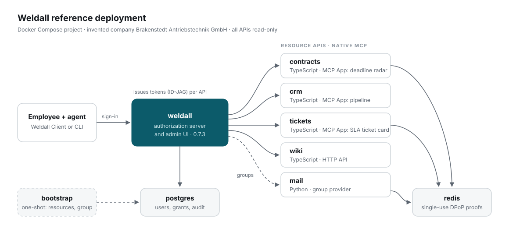

<p align="center">
  
</p>

<p align="center">
  <a href="https://github.com/seibert-external/weldall/blob/main/LICENSE"></a>
  <a href="https://datatracker.ietf.org/doc/html/draft-ietf-oauth-identity-assertion-authz-grant-04"></a>
  <a href="https://datatracker.ietf.org/doc/html/draft-parecki-oauth-jwt-dpop-grant-01"></a>
  <a href="https://www.rfc-editor.org/rfc/rfc9449.html"></a>
  <a href="https://www.rfc-editor.org/rfc/rfc8252.html"></a>
  <a href="https://docs.weldall.ai"></a>
</p>

---

# Weldall reference deployment

This is an example of how to set up services for [Weldall](https://weldall.ai), and the public demo
behind "Demo verbinden" in the Weldall Client. It runs on Docker Compose and contains an authorization
server, five read-only resource servers in two languages and a group provider for memberships. The
product itself lives in [seibert-external/weldall](https://github.com/seibert-external/weldall).

The data belongs to an invented German company, Brakenstedt Antriebstechnik GmbH: a contract
register, a CRM with pipeline, a ticket system, a wiki and a shared sales mailbox. All names are
invented and the records refer to each other: a contract's `customerId` is a CRM organisation, a
ticket names its contract, a mail points to its ticket, contract and deal.

<p align="center">
  
</p>

## Services

| Service | Role | What it shows about a deployment |
|---|---|---|
| `weldall` | Authorization server and admin UI, built unmodified from pinned Weldall 0.7.3 source | Upstream runs as one container against PostgreSQL with a public HTTPS origin, an ES256 signing key, a credential-encryption key and an independent connector key-encryption key. Sign-in providers are database rows configured once at `/setup`. Migrations run on start. |
| `contracts` | Contract register (TypeScript/Hono), 18 contracts with clauses | HTTP API plus native MCP with an MCP App: deadline radar and contract dossier. |
| `crm` | CRM (TypeScript/Hono): 12 organisations, contacts, history, 14 deals | HTTP API plus native MCP with an MCP App: pipeline board and deal detail. |
| `tickets` | Ticket system (TypeScript/Hono), 13 Jira-like tickets with SLA and history | HTTP API plus native MCP with an MCP App: ticket card and ticket list. |
| `wiki` | Wiki (TypeScript/Hono), 10 Confluence-like pages in 4 spaces | HTTP API only. |
| `mail` | Shared sales mailbox (Python/FastAPI), 12 messages | The Python SDK, and the group provider interface: the authorization server calls a Token-authenticated directory on this service to resolve group membership. |
| `postgres` | Database | Stores users, grants, resources, skill catalogs and audit records. |
| `redis` | Replay store | DPoP proofs are single-use. The APIs stop answering when Redis is unreachable. |
| `bootstrap` | One-shot job that exits 0 | Registers resources, scopes and the `demo-readers` group in one transaction. The same changes are available in the admin UI. |

The four Node services share one image (`services/node`); the container argument picks the service.

Dates move with the calendar so the demo does not age. Records are written as of 28 October 2026 and
move by whole days, and the demo clock stands at 11:30 every day: a deadline "in 3 days" and an SLA
with 3:40 h left read the same on any day and at any hour.

## Skills

| Resource | Skills (start skills first) |
|---|---|
| `contracts` | `start-fristen` „Welche Verträge laufen bis Jahresende aus?“ · `renewals` · `review` · `by-account` |
| `crm` | `start-pipeline` „Wie steht unsere Vertriebspipeline?“ · `start-kundenbriefing` „Bereite mich auf den Termin mit der Papierfabrik Rehwinkel vor“ · `briefing` · `pipeline` |
| `tickets` | `start-stoerungen` „Welche Störungen sind gerade kritisch?“ · `ticket-status` · `customer-tickets` |
| `wiki` | `search` |
| `mail` | `start-postfach` „Was ist heute im Vertriebspostfach wichtig?“ · `search` |

Start skills carry the tag `start`; their title is the prompt to try.

## MCP Apps

`contracts`, `crm` and `tickets` serve native MCP at `/api/mcp` with one view each
(`ui://weldall/contracts`, `ui://weldall/pipeline`, `ui://weldall/tickets`). The view HTML is a
static shell; records arrive with the tool result, so the HTML never carries data. The browser code in
`services/node/view` is public, plain ES modules from the resource's own origin (no CDN, no build
step, no `fetch`): `connectDomains` stays empty. Charts and gauges are
plain DOM and SVG. Surfaces, radii and fonts follow the host's MCP style variables, with light and dark
fallbacks; one accent draws the charts, and red, amber and green mark status only. Views call only
their own read tools (open a contract, a deal, a ticket); other actions go through the host: a prompt
into the chat, model context, and a calendar file (`.ics`) through the host's download dialog. Text-only
clients get the same content as text.

Views need a client with the Weldall MCP Apps bridge and Weldall CLI 0.22.1 or newer.

To work on a view, start the Node services with the development-only MCP entry and point the
[Weldall App Devhost](https://github.com/seibert-external/weldall-app-devhost) at it:

```sh
cd services/node && NODE_ENV=development WELDALL_DEV_MCP=1 npx tsx watch src/dev.ts
npx github:seibert-external/weldall-app-devhost --target http://localhost:4101/dev/mcp --name Verträge
```

`/dev/mcp` answers 404 unless both variables are set; containers never set them.

## Deploy

1. `npm run generate-env` writes `.env` with new ES256 keys and random secrets, mode `0600`. It does
   not overwrite an existing file. An existing deployment keeps its keys: compare it with
   `.env.example`, generate a scratch file in another checkout and copy over only the variables it lacks.
   Compose stops with `Required` on any that are missing.
2. Set `WELDALL_ISSUER`, `CONTRACTS_ORIGIN`, `CRM_ORIGIN`, `TICKETS_ORIGIN`, `WIKI_ORIGIN` and
   `MAIL_ORIGIN` to six distinct HTTPS origins without a trailing slash.
3. Deploy `compose.yaml`. In Coolify: build pack *Docker Compose*, compose location `/compose.yaml`,
   domains on `weldall:3000`, `contracts:3001`, `crm:8000`, `tickets:3003`, `wiki:3004` and
   `mail:8000`. `postgres`, `redis` and `bootstrap` belong to this Compose project; they need neither
   a domain nor a separate database resource.
4. Open `https://<WELDALL_ISSUER>/setup` and register an OIDC provider. The form displays the
   callback URL to register with the provider. Authorization answers `503` until this step is done.
5. Point the CLI at the deployment: `weldall config set-issuer https://<WELDALL_ISSUER>`, then
   `weldall login` and `weldall skills list`.

Before the demo is open to everyone, publish the privacy notice and retention policy:
[German](docs/datenschutz.md), [English](docs/privacy.md).

## Limitations

- Use a dedicated database. The example records and the reader policy are not suitable for an
  existing instance.
- Signing keys, both encryption keys, the PostgreSQL volume and the Redis volume stay unchanged
  across deployments.
- Back up PostgreSQL and Redis together. Losing replay history makes already-used proofs reusable.
- The `demo-readers` group maps every verified email to read-only access on all five APIs. It is an
  example policy, not an identity check. Publish the privacy notice and retention policy first
  ([German](docs/datenschutz.md), [English](docs/privacy.md)).
- Deleting the application resource in Coolify runs `docker compose down -v` and removes all state.
  A redeploy does not.

Checks: `npm run check`. In `services/mail`: `uv run ruff format --check . && uv run ruff check . && uv run pytest -q`.
Containers: `node scripts/test-containers.mjs`; the whole local stack behind Caddy: `node test/local.integration.mjs`.

`package.json` overrides `zod` (≥ 4.6.6, GHSA-mrhx-c7xc-m3w5; `@weldall/sdk` 0.12.2 pins 4.4.3) and
`hono` (4.13.14) for every dependency.
